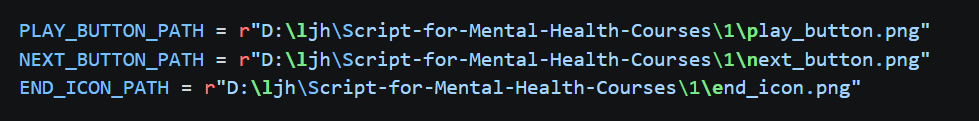

# 🎓 华科心理健康教育电脑端刷课脚本

> **⚠️ 免责声明：**
> 仅供学习使用，禁止用于其他用途。
> 本脚本参考 [sorryqin/Script-for-Mental-Health-Courses](https://github.com/sorryqin/Script-for-Mental-Health-Courses) 的思路，做了一些优化的脚本改进。

---

## 🛠️ 使用方法

### 1. 路径准备
建议将项目克隆到**非中文路径**下，否则可能会因为编码问题导致报错。

### 2. 环境配置

推荐使用 Conda 创建虚拟环境：

```bash
# 创建环境（建议将 3.11 换成当前环境的 Python 版本）
conda create -n scripts python=3.11 -y

# 激活环境
conda activate scripts

# 安装 pip
conda install pip

# 安装当前环境导出的依赖
pip install -r requirements.txt
<font size="2" color="gray">如果没有安装 conda，可以使用以下原生 Python 指令：</font>

bash
# 创建虚拟环境，目录名为 .venv
python -m venv .venv

# 激活虚拟环境 (PowerShell)
.\.venv\Scripts\Activate.ps1

# 安装依赖
python -m pip install -r requirements.txt
3. 打开课程平台
用浏览器打开我们的课程平台：

<div align="center">  </div> <br>
4. 修改脚本路径
打开 main.py 修改图片路径，换成你当前电脑上的绝对路径：

<div align="center">  </div> <br>
5. ⚠️ 重要前置操作（关于章节测验）
由于心理健康教育课程有章节测验，本脚本仅支持播放视频（各位大佬后续可以优化自动完成章节测验的功能）。
因此在使用脚本刷课前，需要各位人工将右边每一章中含有“2”的那一小节的章节测验做完。

💡 提示： 章节测验是可以无数次重复提交的，各位不要有心理压力。

<div align="center">  </div> <br>
6. 运行脚本
在终端中运行 main.py：

bash
python main.py
运行后，将页面切回浏览器课程页面，脚本即会自动开始刷课。

7. 清理环境
刷课结束后，记得将创建的虚拟环境删除以释放磁盘空间。

