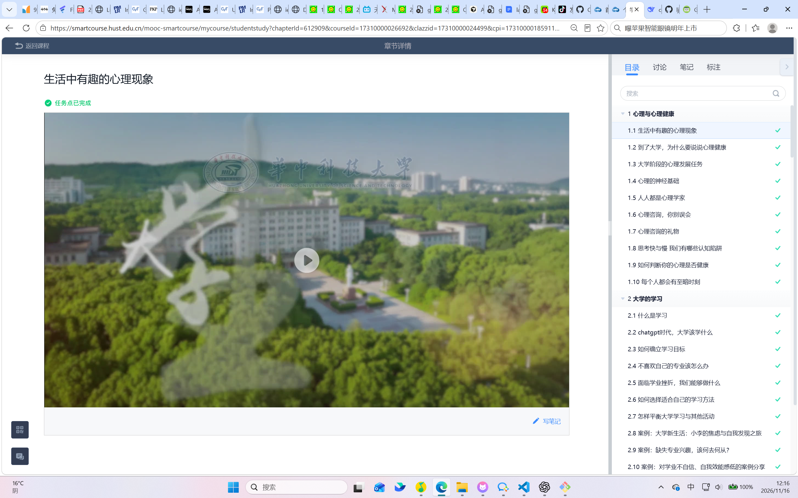
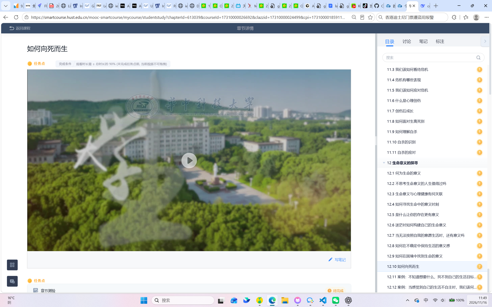

# 🎓 华科心理健康教育电脑端刷课脚本

> ⚠️ **免责声明**
>
> 本项目仅供学习交流使用，请遵守课程平台的相关规定。
>
> 本脚本参考了 [sorryqin/Script-for-Mental-Health-Courses](https://github.com/sorryqin/Script-for-Mental-Health-Courses) 的思路，并在此基础上进行了优化和改进。

## 🛠️ 使用方法

### 1. 准备项目

将项目克隆或下载到本地。建议使用不包含中文的路径，以减少可能遇到的路径编码问题。

```powershell
git clone https://github.com/ljhawsome666/HUST_Mental-Health_course_script.git
cd Script-for-Mental-Health-Courses
```


### 2. 配置运行环境

需要先安装 Python。推荐使用与开发时相同的 Python 版本。

#### 方式一：使用 Conda

```powershell
# 创建环境；请按实际情况调整 Python 版本
conda create -n scripts python=3.11 pip -y

# 激活环境
conda activate scripts

# 安装依赖
python -m pip install -r requirements.txt
```

#### 方式二：使用 Python 自带的 venv

如果没有安装 Conda，可以在 Windows PowerShell 中运行：

```powershell
# 创建虚拟环境
python -m venv .venv

# 激活虚拟环境
.\.venv\Scripts\Activate.ps1

# 安装依赖
python -m pip install -r requirements.txt
```

如果 PowerShell 提示禁止运行脚本，可以先在当前窗口运行以下命令，然后重新执行激活命令：

```powershell
Set-ExecutionPolicy -Scope Process -ExecutionPolicy RemoteSigned
```

### 3. 打开课程页面

在浏览器中登录课程平台，打开需要学习的课程页面。

<div align="center">
  
</div>


### 4. 提前完成章节测验

本脚本用于播放视频，**不支持自动完成章节测验**。运行脚本前，请手动完成课程中需要完成的章节测验，将该课程中所有的章节测验先单独完成再运行脚本，章节测验可以无限提交。

💡 课程目录中，含有“2”的小节可能同时包含视频和章节测验，请打开对应小节检查。

<div align="center">
  
</div>

### 5. 运行脚本

在已激活虚拟环境的终端中运行：

```powershell
python main.py
```

运行后切回浏览器课程页面。脚本会识别播放按钮和视频任务完成状态，并在满足条件后查找下一节。

可以手动开二倍速完成时间更快

运行过程中，可以将鼠标移至屏幕左上角，触发紧急停止。

### 6. 退出和清理环境

使用完成后，在终端中退出虚拟环境：

```powershell
deactivate
```

如果不再需要该环境，可以按创建方式删除：

- **Conda 环境：**

  ```powershell
  conda env remove -n scripts
  ```

- **venv 环境：**退出环境后，删除项目目录中的 `.venv` 文件夹。